 

&nbsp;&nbsp;&nbsp;

  

 

  

 

I'm a Back-End Developer specialized in Laravel (PHP). I build robust RESTful APIs, design optimized MySQL databases, and care about performance and scalability. I'm passionate about clean architecture, automation, and delivering real-world backend solutions. Right now I'm exploring Redis, AWS, and Docker.

 

  
   
  

 

  
  
   
  

 

  
    
  

 

